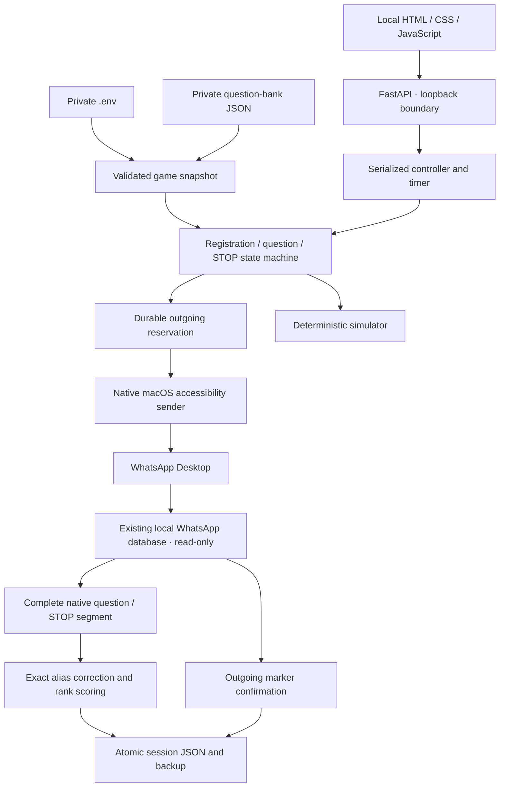

# WhatsApp Quiz Studio for macOS

A local quiz host for WhatsApp Desktop: explicit aliases, chronological first answers, transparent rank-based points and private JSON storage. There is **no LLM, WhatsApp Web or cloud service**. Application data stays in JSON. Incoming messages are read from WhatsApp Desktop’s existing local SQLite database through read-only connections; the bot never writes to that database.

The application includes a local question editor, an answer tester, a deterministic simulator, direct native message reading, an accessibility sender, durable game snapshots and explicit incident recovery. **Native gameplay is gated by a controlled transport test. It has not yet been validated in a real quiz round.** Direct reading has recovered 100 local records without scrolling, preserving their authors, timestamps and native sequence. That diagnostic does not replace a controlled question/STOP test.

## Requirements and limitations

- **macOS only**, on a Mac laptop or desktop. Python 3.12 is recommended; PyObjC supplies the native APIs. See [PyObjC supported platforms](https://pyobjc.readthedocs.io/en/latest/supported-platforms.html).
- WhatsApp Desktop must be installed, signed in, unlocked and showing the exact target conversation. Open the group yourself; the service does not guess a group from search results.
- Keep WhatsApp available while a native game is running. Avoid navigating to another chat, editing messages or changing the desktop during collection.
- WhatsApp’s internal database schema and accessibility selectors are undocumented and version-dependent. Missing metadata, markers, native sequence values or changed observations pause a game instead of producing a partial leaderboard.
- Reading covers **locally synchronized records**, not the full cloud history. A fresh read transaction includes the live database journal. Missing or unavailable local data blocks collection; no completeness claim is made about unsynchronized messages.
- Native sender identities are hashed before application storage. Two participants sharing a display name remain separate players, with short identity suffixes in results. Missing sender identities for answers or registrations block scoring. Names are not verified real-world identities.
- The database supplies native timestamps with seconds and a conversation sequence. Eligibility and rank use the strict native sequence between the outgoing question and STOP markers, rather than clock comparisons or display order.
- The current implementation was checked on macOS 26.6.2, Python 3.12 and PyObjC 12.2.2. Other supported combinations require their own native validation.
- This service does not automatically resume after a crash, logout or shutdown. Timers work only while the local process is running. Recovery always requires an operator action.

## Install and start

From the project directory:

```sh
python3.12 -m venv .venv
source .venv/bin/activate
python -m pip install -r requirements.txt
cp .env.example .env
mkdir -p data
cp questions.example.json data/questions.json
python -m quiz_app
```

Open **http://127.0.0.1:8765**. The server binds only to loopback and uses one worker. A process lock prevents multiple services sharing the same private data directory. Do not expose it through a proxy or bind it to a public interface.

Edit `.env` before starting a game. Every new game snapshots these settings and the selected questions; changing the bank or defaults never changes a running game.

| Variable | Example | Meaning |
|---|---:|---|
| `WHATSAPP_GROUP` | `Test` | Exact currently visible native group name |
| `MAX_PLAYERS` | 20 | Registration limit; enrolled count freezes at closure |
| `MAX_QUESTIONS` | 30 | Maximum questions per game |
| `REGISTRATION_SECONDS` | 60 | Registration window |
| `QUESTION_SECONDS` | 30 | Answer window before publishing STOP |
| `INTERVAL_SECONDS` | 10 | Delay after round results |
| `POLL_SECONDS` | 1 | Engine polling delay |
| `JOIN_COMMAND` | `!join` | Case-insensitive enrollment command |
| `ANSWER_PREFIX` | `!r` | Case-insensitive answer command |
| `IGNORE_ACCENTS` | true | Optional accent removal |
| `MAX_POINTS`, `MIN_POINTS` | 100, 20 | Correct-answer scoring endpoints |
| `MAX_HISTORY_PAGES` | 1000 | Traversal budget for the legacy accessibility diagnostic only |
| `WHATSAPP_DATABASE` | Default WhatsApp group-container path | Existing local database; opened read-only |
| `MESSAGE_CHUNK_SIZE` | 3000 | Outgoing message size, including boundary markers |
| `PORT` | 8765 | Local HTTP port |

Use double quotes around text values. Invalid fields, duplicate keys, conflicting commands and inverted point limits fail validation explicitly.

## Questions and correction

The JSON editor accepts a nonempty array with unique stable IDs:

```json
[
  {
    "id": "capital",
    "question": "What is the capital of France?",
    "answer": "Paris",
    "aliases": ["Ville de Paris"],
    "explanation": "Paris is the capital of France."
  }
]
```

Save, import or export the bank from the dashboard. The tester shows whether a candidate matches and the original official answer or alias that matched.

Correction normalizes Unicode, letter case, whitespace and curly apostrophes. Accent removal is optional. Common terminal punctuation is removed, while `C++`, `C#` and `-5` remain significant. Matching requires complete equality: typos, partial names, added negations and multiple alternatives are rejected. Add explicitly accepted forms to `aliases`.

## Rehearse without sending anything

1. Click **Start simulation**; all bank questions are selected, up to the configured limit.
2. Submit `!join` with fictional player names from **Simulate a player**.
3. When enrollment closes, submit `!r Paris` for the active question. No question number is needed.
4. Watch the STOP, results, next question and final scoreboard in the stored session evidence.

Simulation never opens or publishes to WhatsApp. Use shorter local durations if desired. Only the first nonempty command-form answer from each registered player counts. Answers between STOP and the next question are ignored. A reply after the next question belongs to that new round.

## Permissions and native diagnostics

In **System Settings → Privacy & Security → Accessibility**, enable the terminal used for manual commands and the actual Python executable used to start the service. macOS grants can differ between the terminal and a background launcher.

Find the real executable:

```sh
.venv/bin/python -c 'import os, sys; print(os.path.realpath(sys.executable))'
```

Click **+**, then **Cmd+Shift+G** and paste that path. If the picker hides the executable, select it in Finder and drag it into the Accessibility list; enable its switch. Restart the terminal/service after granting access if needed. See [Apple Accessibility settings](https://support.apple.com/en-gb/guide/mac-help/mchl211c911f/27/mac/27).

Database reading also requires macOS to permit access to the configured WhatsApp group-container file. Accessibility permission does not itself grant file access. If reading reports `SOURCE_UNAVAILABLE`, check the path and operating-system denial first. Grant Full Disk Access to the actual launching terminal or Python only if macOS denies this source; use **Privacy & Security → Full Disk Access** and the same executable-selection procedure. Do not copy the live database or its journal into Git.

Read the latest 100 local records **without scrolling or sending**:

```sh
python -m scripts.read_messages --group "Test" --count 100
# Optional private export, including authors, UTC timestamps and exact bodies:
python -m scripts.read_messages --group "Test" --count 100 --output data/diagnostics/test.json
```

The count includes records without a text body. The command reports how many records actually exist locally; it does not invent missing history. Complete quiz-window reads have no viewport limit and are scoped to one exact group.

The older accessibility prototype remains available as a **read-only diagnostic**, not the production history reader:

```sh
python -m scripts.probe_whatsapp --group "Test"
```

It prints row counts and order/overlap diagnostics, without printing message contents, saving them or sending messages. Permission denial is explicit. A failed overlap is a failure to establish continuity, even if the visible rows individually look correct.

### Controlled test, prepared for later

Do not enable real play on the strength of unit tests or a viewport inspection alone. Arrange at least three known incoming replies from another account, in a known order. Use distinct participant labels for this human-readable validation fixture. Store the expected transcript privately in `data/expected.json`, for example:

```json
[
  {"author": "Camille", "body": "!r Paris"},
  {"author": "Camille", "body": "!r Londres"},
  {"author": "Robin", "body": "!r Paris"}
]
```

These are fictional labels; replace them with the actual test accounts and agreed responses. **The following command sends a question boundary and STOP in Test:**

```sh
python -m scripts.validate_transport --expected data/expected.json --seconds 30
```

Stop the web service before this command: the validator acquires the same exclusive service lock. Open Test first and ensure the message composer is empty and focused. Send the agreed replies during the announced window. The test compares the complete recovered segment with the exact expected authors, bodies and order. Success writes a private validation receipt. Only then does **Start in WhatsApp** become available for the matching group. Restart or reload the dashboard after successful validation.

Each validation send is reserved in a private diagnostic JSON before publication. A missed or uncertain send is never silently retried. Inspect WhatsApp and that reserved message first; the validator does not automatically recover or replay an interrupted attempt. This test is currently restricted to Test; adapting and validating another target group is a separate explicit operator step.

## Scoring

With `N` registered players and a correct-answer rank `r`:

```text
points = round_half_up(MAX_POINTS − (MAX_POINTS − MIN_POINTS) × (r − 1) / (N − 1))
```

For one player, a correct answer receives `MAX_POINTS`. Incorrect and absent replies receive zero. Only correct replies advance `r`; absent/incorrect players remain in `N`. At defaults, 50 players receive 100 for the first correct reply, 61 for the 25th and 20 for the 50th. Equal final totals share a competition rank (1, 1, 3). Final reports include each player's points per question and are split into bounded messages.

## Storage and recovery

`data/questions.json` is the private bank. Each `data/sessions/<id>.json` contains the settings/question snapshot, enrollment, immutable first observations, corrections, points, phase, deadlines and outgoing reservations. Simulation transcripts are also saved so inspection survives a restart.

Writes use a private temporary file, `fsync`, atomic replacement, a nonblocking file lock and a previous-good `.backup.json`. Corrupt files are never silently repaired or overwritten. A send is reserved as `pending` before publication and becomes `sent` only after confirmation.

After interruption, enter the session ID in **Recover an archived game**. Loading keeps the game paused. **Verify sends & resume** checks every pending marker against recoverable history before resuming the saved phase. A marker that cannot be verified blocks resumption. Check WhatsApp manually; if a reserved draft exists, review and send it yourself before verification, or cancel the game. Never edit the outbox statuses to force a replay. **Stop game** cancels locally without publishing an extra message.

A collection incident retains the previous observations and does not announce a complete scoreboard. Changed or deleted replies require review; the bot does not treat an edit as a second attempt. Storage failures pause the in-memory controller and must be resolved before a durable recovery. To restore a backup, stop the service, preserve the failed document, copy the validated backup to its original name, restart and load the archive through the interface.

## Architecture



Python/Pydantic validate contracts; FastAPI serves the local control plane. PyObjC exposes Cocoa (`NSWorkspace` and clipboard integration), ApplicationServices (AX permissions, attributes and actions) and Quartz (foreground-checked input events). Python’s `sqlite3` opens WhatsApp’s existing source with `mode=ro`, `query_only` and a consistent transaction. Group queries are exact and parameterized. Native message identifiers preserve distinct repeated texts; sender identifiers separate identical display names. The reader rejects missing/tied sequence values and duplicated message identifiers. First observations are compared with the final recovered segment; edits or deletions cause an incident rather than a second attempt.

Accessibility pagination remains a diagnostic fallback prototype. Its UI cells can be virtualized and reused, so it is not evidence that an entire history has been recovered. Production collection and send confirmation use the native database. Application locks, write-ahead reservations, atomic JSON replacement and backups remain separate from this read-only external source.

| File | Responsibility |
|---|---|
| `.env.example` | Fictional operational defaults |
| `questions.example.json` | Fictional question bank |
| `quiz_app/config.py` | Strict `.env` parsing and validation |
| `quiz_app/models.py`, `errors.py` | Typed schemas and classified errors |
| `quiz_app/grading.py` | Normalization, command extraction and exact aliases |
| `quiz_app/scoring.py` | Decimal half-up points and tied standings |
| `quiz_app/history.py` | Boundaries, page overlap and immutable observations |
| `quiz_app/transport.py` | Transport interface and no-send simulator |
| `quiz_app/database_reader.py` | Read-only native source, stable identities, complete windows and send confirmation |
| `quiz_app/native.py` | Legacy accessibility metadata and traversal diagnostic |
| `quiz_app/ax_reader.py` | Read-only native permissions, tree, rows and scrolling |
| `quiz_app/scrolling.py` | Foreground-checked small wheel steps with verified table geometry |
| `quiz_app/ax_sender.py` | Empty-draft checks, clipboard preservation and confirmed sending |
| `quiz_app/engine.py` | Game phases, reservations, reports and recovery |
| `quiz_app/storage.py`, `repository.py` | Locks, atomic writes, backups and schema validation |
| `quiz_app/app.py`, `__main__.py` | Local HTTP endpoints and service launcher |
| `quiz_app/static/` | Responsive dashboard, safe DOM rendering and pure view helpers |
| `scripts/read_messages.py` | Fast read-only message-count diagnostic and optional private export |
| `scripts/probe_whatsapp.py` | Legacy read-only accessibility prototype |
| `scripts/validate_transport.py` | Explicit controlled native test in Test |
| `scripts/check_coverage.py` | Exact Python line/branch quality gates |
| `tests/` | Rules, native fakes, recovery, storage, HTTP and large-game simulations |
| `tests/frontend/` | JavaScript helpers and dashboard interactions |
| `pyproject.toml` | Python tests, lint, typing and coverage configuration |
| `requirements*.txt` | Runtime and developer dependencies |
| `package.json`, `package-lock.json` | Reproducible frontend test/lint dependencies |
| `eslint.config.js`, `vitest.config.js` | JavaScript complexity and coverage gates |
| `.github/workflows/ci.yml` | macOS Python/JavaScript checks, without native messages |
| `.gitignore` | Private settings, games, logs and generated artifacts |
| `LICENSE` | MIT license |

## Developer checks

Python 3.12 and Node.js 24.15+:

```sh
python -m pip install -r requirements-dev.txt
npm ci
python -m pytest
python scripts/check_coverage.py
ruff check quiz_app scripts
ruff format --check quiz_app scripts
mypy quiz_app
complexipy quiz_app scripts --max-complexity-allowed 10
npm run lint
npm test
```

Quality gates enforce 100% application lines, at least 90% Python/JavaScript branches, full JavaScript function coverage, and 100% corrector/scorer branches. Cognitive complexity is limited to 10 per Python function with [complexipy](https://complexipy.com/usage-guide/) and JavaScript function with [SonarJS](https://github.com/SonarSource/SonarJS). Tests use simulated native dependencies and never send WhatsApp messages. Coverage is evidence about executed paths, not a guarantee of correctness; see [branch coverage](https://coverage.readthedocs.io/en/6.5.0/branch.html).

Real transport validation remains a separate acceptance step. Keep private `.env`, bank, sessions, validation fixtures, diagnostics and message history out of Git.
